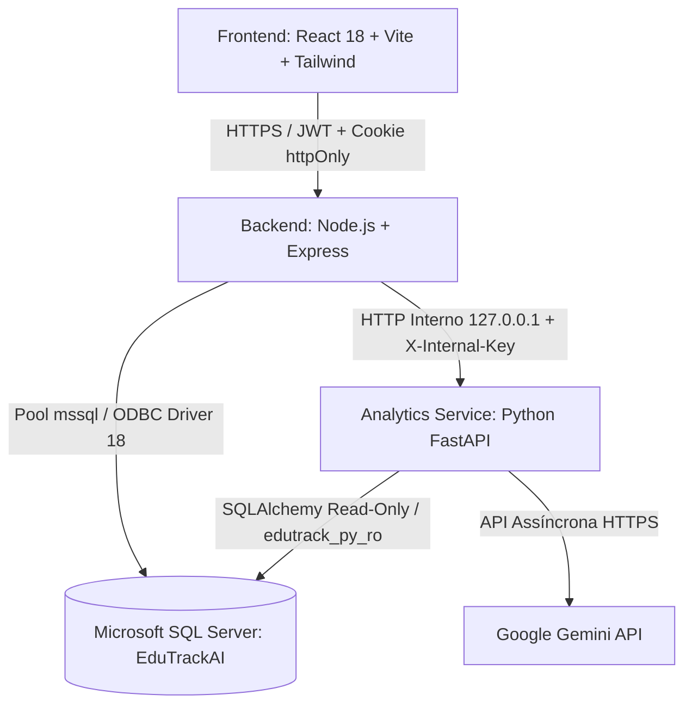
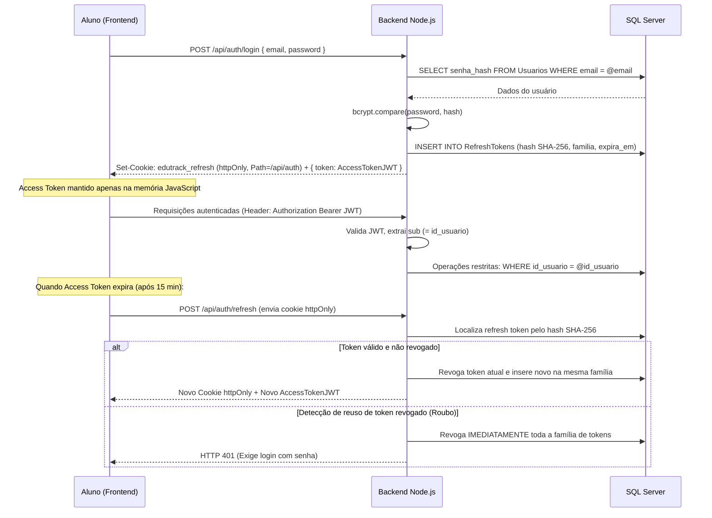

# Arquitetura do Sistema — EduTrack AI v2

Este documento descreve a topologia, fluxo de dados, políticas de segurança e divisão de responsabilidades do **EduTrack AI v2**, conforme as diretrizes da especificação técnica.

---

## 1. Visão Geral da Arquitetura

O sistema é construído sobre uma arquitetura híbrida de microsserviços orientada a alto desempenho e segurança:

### Componentes Principais

1. **Frontend (`frontend/`)**:
   - Desenvolvido em React 18 com Vite e Tailwind CSS.
   - Suporte completo a temas Claro, Escuro e Automático (Sistema).
   - Escala dinâmica de fontes para acessibilidade (Normal 100%, Grande 115%, Muito Grande 130%).
   - Layout responsivo Mobile-First com barra inferior (< 768px) e mini-widget do cronômetro.
   - Gerenciamento de Access Token **estritamente em memória** com silent refresh transparente via cookie `httpOnly`.

2. **Backend Node.js (`backend/`)**:
   - API REST responsável pelo ciclo de autenticação, CRUD de entidades, controle de sessões de tempo e proxy com cache.
   - Emissão de Access Token JWT (15 min) e rotação de Refresh Token (7 dias) com detecção de reuso.
   - Isolamento de dados por usuário baseado exclusivamente na claim `sub` do JWT validado.

3. **Analytics Service Python (`analytics-service/`)**:
   - Microsserviço FastAPI rápido escutando exclusivamente em `127.0.0.1:8000` protegido por chave interna `X-Internal-Key`.
   - Conexão somente leitura ao SQL Server via login dedicado `edutrack_py_ro`.
   - Responsável por:
     - Cálculo de progresso ponderado por carga horária e peso de tarefas.
     - Previsão estatística de conclusão combinando velocidade recente ponderada (pesos 4, 3, 2 e 1).
     - Motor híbrido de recomendações (9 regras determinísticas + enriquecimento assíncrono via SDK `google-genai`).
     - Geração assíncrona de relatórios semanais em PDF A4 com ReportLab e gráficos em alta resolução Matplotlib.

4. **Banco de Dados Relacional (`database/`)**:
   - Microsoft SQL Server (`localhost\SQLEXPRESS`), banco `EduTrackAI`.
   - 9 tabelas estruturadas com integridade referencial estrita e índices de cobertura.

---

## 2. Fluxo de Autenticação e Segurança (Seção 10.1)

---

## 3. Isolamento Estrito de Dados Privados

- O `id_usuario` é obtido **obrigatoriamente** da assinatura criptográfica do JWT (`sub`).
- Parâmetros de URL, corpo da requisição ou query strings **jamais** sobrepõem o `id_usuario`.
- Tentativas de acessar disciplinas, tarefas ou sessões de outros alunos respondem com **HTTP 404** (não 403), eliminando qualquer vazamento por enumeração de identificadores numéricos.
