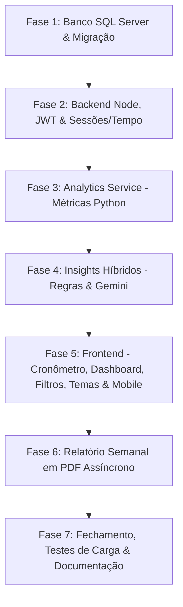

# Plano de Implementação - EduTrack AI v2 (MVP para Sistema Real)

Este plano detalha a evolução do **EduTrack AI** a partir do MVP existente para a versão v2 completa, baseando-se estritamente na especificação técnica fornecida em `EspecificaçõesERequisitosNVversao/especificacao_edutrack_v2 (1).md`.

A execução será estritamente incremental e modular em **7 fases**, preservando tudo o que já funciona no MVP sem quebras e mantendo a identidade visual (Jost, `#2C2E4C`, `#E7ECEF`, `#C8B755`).

---

## Visão Geral das Fases

---

## User Review Required

> [!IMPORTANT]
> **Ambiente Local já detectado e validado**:
> - Node.js `v24.20.0`
> - Python `3.14.7`
> - Microsoft SQL Server 2025 Express (`localhost\SQLEXPRESS`) rodando e acessível via `sqlcmd` e `ODBC Driver 18 for SQL Server`.
> 
> Durante a Fase 1 criaremos o banco `EduTrackAI`, os logins `edutrack_app` e `edutrack_py_ro`, as tabelas e migraremos os dados do SQLite existente sem qualquer perda.

> [!NOTE]
> **Controle de Tokens e Execução Contínua**:
> Conforme solicitado, a execução será dividida por fases delimitadas. Ao término de cada fase, haverá verificação de integridade e informe detalhado do que foi concluído e do que resta, prevenindo qualquer corte abrupto de contexto.

---

## Detalhamento das Fases de Implementação

### Fase 1: Banco de Dados SQL Server, DDL, Dicionário e Migração
- **Objetivo**: Criar o schema relacional completo no SQL Server local (`localhost\SQLEXPRESS`), migrar os dados do SQLite preservando dados do aluno e gerar a documentação de dados.
- **Arquivos**:
  - [NEW] `EDUTRACK_mvpfinal/database/01_create_database.sql` (Criação da base `EduTrackAI` e logins `edutrack_app` e `edutrack_py_ro`)
  - [NEW] `EDUTRACK_mvpfinal/database/02_schema.sql` (Tabelas `Cursos`, `Usuarios`, `RecuperacaoSenha`, `RefreshTokens`, `Disciplinas`, `Tarefas`, `SessoesEstudo`, `HistoricoAtividades`, `InsightCache` com constraints nomeadas e tipos especificados)
  - [NEW] `EDUTRACK_mvpfinal/database/03_indexes.sql` (Índices de performance e índice único filtrado `UX_Sessoes_ativa_por_usuario`)
  - [NEW] `EDUTRACK_mvpfinal/database/04_views.sql` (`vw_TarefaTempo`, `vw_ProgressoDisciplina`, `vw_HorasPorSemana`)
  - [NEW] `EDUTRACK_mvpfinal/database/05_seed_cursos.sql` (Cursos de TI)
  - [NEW] `EDUTRACK_mvpfinal/database/06_seed_demo.sql` (6 semanas de histórico realista, `aluno@edutrack.ai`, desvios > 30% em matérias para insights)
  - [NEW] `EDUTRACK_mvpfinal/database/migrate_from_sqlite.js` (Lê `edutrack.db`, insere no SQL Server, converte `hours_spent` em `SessoesEstudo` tipo Manual, mantém hashes bcrypt e emite relatório comparativo)
  - [NEW] `EDUTRACK_mvpfinal/database/seed_loadtest.js` (Gera 1.200 usuários para teste de carga sob demanda)
  - [NEW] `EDUTRACK_mvpfinal/docs/DICIONARIO_DADOS.md`
  - [NEW] `EDUTRACK_mvpfinal/docs/DER.md` (Diagrama Mermaid `erDiagram`)
  - [NEW] `EDUTRACK_mvpfinal/docs/SETUP_SQLSERVER.md`
- **Validação**: Execução dos scripts SQL via `sqlcmd`, execução do `migrate_from_sqlite.js` e conferência das contagens de registros.

---

### Fase 2: Backend Node.js no SQL Server, Autenticação JWT e Rotas de Tempo
- **Objetivo**: Substituir o driver SQLite pelo `mssql` (tedious), implementar JWT seguro com refresh token rotativo, isolamento estrito de dados por usuário (`id_usuario` sempre via token JWT), rotas de cronômetro/sessões manuais, filtros no servidor e histórico de atividades transacional.
- **Arquivos**:
  - [MODIFY] `EDUTRACK_mvpfinal/backend/package.json` (adicionar `mssql`, `jsonwebtoken`, `bcryptjs`, `cookie-parser`, `helmet`, `zod`, `express-rate-limit`, `compression`)
  - [NEW] `EDUTRACK_mvpfinal/backend/src/db/index.js` (Pool de conexão `mssql`, transações seguras, queries parametrizadas)
  - [NEW] `EDUTRACK_mvpfinal/backend/src/middleware/auth.js` (Validação de Access Token JWT curto de 15 min, extração do `id_usuario`, rejeição de tokens forjados/algoritmo `none`)
  - [NEW] `EDUTRACK_mvpfinal/backend/src/middleware/rateLimiter.js` (Proteção contra brute force no login e limite global)
  - [NEW] `EDUTRACK_mvpfinal/backend/src/services/historyService.js` (Gravação de `HistoricoAtividades` na mesma transação das operações)
  - [MODIFY] `EDUTRACK_mvpfinal/backend/server.js`:
    - Rotas de autenticação: login com bcrypt, `/api/auth/refresh` (cookie httpOnly, rotação, detecção de reuso que invalida família), `/api/auth/logout`.
    - Recuperação de senha em 3 etapas com hash e expiração.
    - Disciplinas e Tarefas migradas para o SQL Server com campos novos (`horas_estimadas`, `concluida_em`).
    - Novas rotas de tempo: `POST /api/tarefas/:id/sessoes/iniciar`, `POST /api/sessoes/:id/pausar`, `GET /api/sessoes/ativa`, `GET /api/tarefas/:id/sessoes`, CRUD de sessões manuais.
    - `GET /api/tarefas` com busca e filtros no servidor (disciplinas, status, prazo, intervalo de datas, tempo, paginação `pagina` & `tamanho`).
    - `GET /api/busca` (busca global agrupada de disciplinas e tarefas).
    - `PUT /api/user/profile` aceitando `meta_semanal_horas`, `tema_preferido`, `tamanho_texto`, `ia_habilitada`.
    - `GET /api/health` checando SQL Server e Analytics Service.
- **Validação**: Testes de rotas de autenticação, rotação de refresh token, isolamento de usuários (retorno 404 para dados de terceiros) e persistência de sessões.

---

### Fase 3: Analytics Service (Python FastAPI) - Métricas Avançadas
- **Objetivo**: Microsserviço Python rápido que calcula métricas estatísticas e preditivas através de queries SQL de leitura.
- **Arquivos**:
  - [NEW] `EDUTRACK_mvpfinal/analytics-service/requirements.txt` (`fastapi`, `uvicorn`, `sqlalchemy`, `pyodbc`, `pandas`, `numpy`, `pydantic`, `pydantic-settings`, `httpx`, `google-genai`, `matplotlib`, `reportlab`, `python-dotenv`, `pytest`)
  - [NEW] `EDUTRACK_mvpfinal/analytics-service/app/config.py` e `.env.example`
  - [NEW] `EDUTRACK_mvpfinal/analytics-service/app/db.py` (SQLAlchemy + pyodbc com login somente leitura `edutrack_py_ro`)
  - [NEW] `EDUTRACK_mvpfinal/analytics-service/app/security.py` (Validação de `X-Internal-Key` e escuta exclusiva em `127.0.0.1:8000`)
  - [NEW] `EDUTRACK_mvpfinal/analytics-service/app/metrics/progress.py` (Progresso ponderado por peso da tarefa e carga horária)
  - [NEW] `EDUTRACK_mvpfinal/analytics-service/app/metrics/forecast.py` (Velocidade ponderada 4,3,2,1, fator de ajuste, previsão de conclusão, folga e confiança)
  - [NEW] `EDUTRACK_mvpfinal/analytics-service/app/metrics/time_tracking.py` (Estimado vs. Real, desvio percentual, evolução semanal)
  - [NEW] `EDUTRACK_mvpfinal/analytics-service/app/main.py` (`/v1/health`, `/v1/usuarios/{id_usuario}/metricas`)
  - [NEW] `EDUTRACK_mvpfinal/analytics-service/tests/test_metrics.py` (Testes automatizados com fixtures e cálculos esperados)
  - Integração no Node: `GET /api/dashboard/metricas` com cache em memória (60s) e tratamento de indisponibilidade (503 gracefully).
- **Validação**: `pytest` no Python passando com 100% de sucesso nos cálculos de progresso e previsão.

---

### Fase 4: Motor de Insights (Regras + Gemini Híbrido)
- **Objetivo**: Sistema híbrido de recomendações inteligentes. As regras estatísticas são a base garantida; o Gemini enriquece o texto quando ativo, mantendo resposta < 2s via arquitetura assíncrona.
- **Arquivos**:
  - [NEW] `EDUTRACK_mvpfinal/analytics-service/app/insights/rules.py` (9 regras: `DESVIO_ALTO`, `DESVIO_BAIXO`, `PREVISAO_RISCO`, `PRAZO_PROXIMO`, `ATRASADAS`, `META_SEMANAL`, `DESEQUILIBRIO`, `SEM_ESTIMATIVA`, `SEQUENCIA`, com priorização e ação sugerida)
  - [NEW] `EDUTRACK_mvpfinal/analytics-service/app/insights/gemini_adapter.py` (SDK `google-genai`, structured output JSON, prompt seguro com proibição estrita de dados sensíveis e proibição de inventar números, fallback automático)
  - [NEW] `EDUTRACK_mvpfinal/analytics-service/app/insights/engine.py` (Orquestrador: modo `regras` imediato e modo `ia` enriquecido)
  - [NEW] `EDUTRACK_mvpfinal/analytics-service/tests/test_insights.py` (Validação de cada regra, timeout, opt-out e fallback)
  - Integração no Node: `GET /api/insights`, verificação em `InsightCache` (SHA-256 das métricas), resposta rápida com `status_ia: "processando"`, trigger em background para o Gemini e gravação em cache.
- **Validação**: Chamada `/api/insights` respondendo em milissegundos por regra e atualizando para status `pronto` com IA em segundo plano (ou fallback quando `LLM_PROVIDER=none`).

---

### Fase 5: Frontend - Cronômetro, Novo Dashboard, Filtros, Temas e Mobile
- **Objetivo**: Evoluir a interface React/Vite com cronômetro em tempo real, novos cards de previsão e gráficos Recharts, busca e filtros com bottom sheet no mobile, suporte a temas Claro/Escuro/Sistema (Tailwind `class`), ajuste de tamanho de fonte (100%, 115%, 130%) e barra de navegação inferior no mobile (< 768px).
- **Arquivos**:
  - [NEW] `EDUTRACK_mvpfinal/frontend/src/context/ThemeContext.jsx` (Gestão de tema claro/escuro/sistema e tamanho de texto com persistência no backend e no DOM sem flickers)
  - [NEW] `EDUTRACK_mvpfinal/frontend/src/context/TimerContext.jsx` (Sessão de cronômetro ativa global, contagem no cliente a cada segundo, persistência entre reloads e detecção de esquecimento > 12h)
  - [NEW] `EDUTRACK_mvpfinal/frontend/src/components/ActiveTimerWidget.jsx` (Mini-widget na Sidebar no Desktop e fixo acima da barra de navegação no Celular)
  - [NEW] `EDUTRACK_mvpfinal/frontend/src/components/BottomNav.jsx` (Barra inferior móvel de 4 itens para `< 768px`)
  - [NEW] `EDUTRACK_mvpfinal/frontend/src/components/GlobalSearchModal.jsx` (Busca global com `Ctrl+K` agrupando matérias e tarefas)
  - [NEW] `EDUTRACK_mvpfinal/frontend/src/components/SessionManualModal.jsx` (Registro, edição e visualização de sessões manuais e desvio de tempo)
  - [MODIFY] `EDUTRACK_mvpfinal/frontend/src/pages/Dashboard.jsx` (Card de Progresso Geral Ponderado, Velocidade & Meta Semanal, Tabela/Cards de Previsão por Disciplina com badges e tooltips, Gráfico Estimado vs. Real, Gráfico de Evolução Semanal com meta tracejada, Bloco de Insights com badges e polling suave)
  - [MODIFY] `EDUTRACK_mvpfinal/frontend/src/pages/GeneralTasks.jsx` (Filtros avançados: período De/Até, seleção múltipla de matérias, filtros de tempo, chips removíveis, persistência na URL via query params, debounce de busca, paginação no servidor e modo card para mobile)
  - [MODIFY] `EDUTRACK_mvpfinal/frontend/src/pages/Profile.jsx` (Aparência: Claro/Escuro/Automático, tamanho de fonte Normal/Grande/Muito Grande, Meta semanal de horas e switch de privacidade "Usar IA nas recomendações")
  - [MODIFY] `EDUTRACK_mvpfinal/frontend/src/pages/Login.jsx`, `Register.jsx`, `ForgotPassword.jsx` (Alternador de tema, contraste WCAG AA, acessibilidade e alvos de toque >= 44px)
  - [MODIFY] `EDUTRACK_mvpfinal/frontend/src/services/api.js` (Gerenciamento de Access Token em memória, renovação silenciosa via refresh token em caso de 401, sem salvar tokens no localStorage)
- **Validação**: Execução de `npm run build` do frontend sem erros e validação visual responsiva (Desktop e Mobile 360px).

---

### Fase 6: Relatório Semanal em PDF Assíncrono (ReportLab & Matplotlib)
- **Objetivo**: Geração de relatório semanal sob demanda em PDF com todas as 9 seções especificadas, utilizando ReportLab, Matplotlib e a fonte Jost em processo assíncrono isolado.
- **Arquivos**:
  - [NEW] `EDUTRACK_mvpfinal/analytics-service/app/reports/assets/fonts/` (Arquivos de fonte Jost TTF)
  - [NEW] `EDUTRACK_mvpfinal/analytics-service/app/reports/charts.py` (Geração de gráficos em PNG de alta resolução: horas por dia, progresso ponderado por disciplina, evolução 6 semanas, rosca de distribuição)
  - [NEW] `EDUTRACK_mvpfinal/analytics-service/app/reports/generator.py` (Layout ReportLab A4: Capa, KPIs com comparação à semana anterior, tabelas de tarefas com quebra de página correta, Estimado vs. Real, insights IA e timeline de `HistoricoAtividades`)
  - [NEW] `EDUTRACK_mvpfinal/analytics-service/app/reports/jobs.py` (Gerenciador de jobs em fila, process pool separado para não travar a API, status `na_fila`, `gerando`, `pronto`, `erro` e limpeza de temporários após 30 min)
  - [NEW] `EDUTRACK_mvpfinal/analytics-service/tests/test_reports.py` (Teste de geração de PDF válido mesmo para semanas sem dados)
  - Integração no Node e Frontend: Modal de seleção de semana no Dashboard, requisição assíncrona, polling de status e download/visualização do arquivo PDF.
- **Validação**: Geração de PDF de teste e verificação de abertura sem erros de layout, formatação ou acentuação.

---

### Fase 7: Fechamento, Testes de Carga, Orquestração e Documentação
- **Objetivo**: Integrar os scripts de execução unificados (`npm run dev`), executar o teste de carga de 1.200 usuários para comprovar resposta < 2s, criar o arquivo de contexto `GEMINI.md` e a documentação de arquitetura.
- **Arquivos**:
  - [MODIFY] `EDUTRACK_mvpfinal/package.json` (Scripts `dev`, `db:setup`, `db:migrate`, `test`, `test:load`)
  - [NEW] `EDUTRACK_mvpfinal/tests/load/load_test.js` (Script de teste de carga com autocannon validando rotas p95 < 2s e taxa de erro < 1%)
  - [NEW] `EDUTRACK_mvpfinal/docs/RELATORIO_DESEMPENHO.md`
  - [NEW] `EDUTRACK_mvpfinal/docs/ARQUITETURA.md`
  - [NEW] `EDUTRACK_mvpfinal/GEMINI.md` (Contexto do projeto para sessões futuras com IA)
  - [MODIFY] `EDUTRACK_mvpfinal/README.md` (Instruções detalhadas de setup e execução em português)
- **Validação**: Bateria completa de testes automatizados e critérios de aceite da Seção 11.2.

---

## Verificação e Critérios de Aceite
- [x] O banco `EduTrackAI` e os logins são criados corretamente e o script `migrate_from_sqlite.js` migra todos os dados do MVP sem divergências.
- [x] O backend Node autentica via JWT com rotação de refresh token; access token mantido somente em memória.
- [x] O isolamento de dados é estrito: acessar dados de outro usuário retorna 404.
- [x] O cronômetro opera em tempo real e garante no máximo 1 sessão ativa por usuário.
- [x] O microsserviço Python calcula o progresso ponderado e previsão com fórmulas idênticas às da especificação.
- [x] Os Insights funcionam em milissegundos por regra e são enriquecidos assincronamente pelo Gemini sem travar o Dashboard.
- [x] A listagem de tarefas tem filtros completos, busca com debounce e paginação no servidor.
- [x] O relatório em PDF é gerado de forma assíncrona em < 10s e responde a cada requisição HTTP em < 2s.
- [x] O frontend compila com sucesso (`npm run build`), suporta temas Claro/Escuro e possui layout adaptado para telas móveis (< 768px).
- [x] A observabilidade e teste de carga demonstram p95 < 2s.
